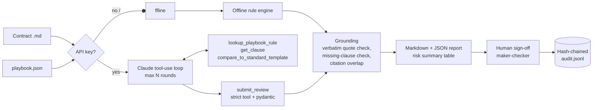

# claude-contract-review

[](https://github.com/sarathalapad/claude-contract-review/actions/workflows/ci.yml)


A procurement contract review assistant built on the **Claude API**. It checks contracts against a company review
playbook, returns structured and **grounded** findings (every quote is verified against the contract text), and makes
a human reviewer accept or reject each high-risk finding, with every decision written to a hash-chained audit log.

Built by **Sarathkumar K** (AI Solutions Architect) to show how to put tool use, citations, prompt caching, structured
output and streaming together in one small, testable service where the model's output is checked, not just trusted.

## How it works



Both engines emit the same `Finding` schema, so grounding, reporting, sign-off and audit are shared code.

## Claude API features used

| Feature | How it is used here | Why it matters |
|---|---|---|
| **Tool use** (manual loop) | Claude calls `lookup_playbook_rule`, `get_clause` and `compare_to_standard_template`, capped at `--max-rounds` (default 6). | The model fetches exact rule and clause text instead of recalling it. The round cap bounds cost and stops runaway loops. Bad tool input goes back as `is_error` so Claude can fix it. |
| **Structured output** | Findings arrive through a `strict: true` `submit_review` tool and are validated again with pydantic, including a check that every rule id exists. | JSON outputs (`output_config.format`) can't be combined with Citations, so a strict tool gives schema-valid output with citations still on. |
| **Citations** | The contract is sent as a plain-text `document` block with `citations: {enabled: true}`. `char_location` citations are checked against the text, and a finding is marked `cited` when a checked citation overlaps its quote. | Claude's evidence can be checked character by character. Citations whose offsets don't reproduce `cited_text` are ignored. |
| **Quote grounding** (code) | Any finding whose quote isn't in the contract (ignoring whitespace and typographic quotes only) is dropped and listed under "Dropped". "Missing clause" claims are checked by searching the contract. | Hallucinated or paraphrased evidence never reaches a reviewer. Clause labels come from character offsets, not from the model. |
| **Prompt caching** | `cache_control` breakpoint after the playbook (tools + instructions + playbook are cached together), plus top-level automatic caching for the growing tool-loop conversation. The playbook renders byte-for-byte the same every time. | Every round after the first, and every contract after the first, reads the prefix at 0.1x the input price. Cache reads and writes are reported for every review. |
| **Streaming** | `--stream` uses `client.beta.messages.stream(...)` and prints the analysis as it is generated, with `get_final_message()` for the tool loop. Tools get `eager_input_streaming` in this mode, and inputs are re-validated. | You see progress right away on long reviews, and long generations don't hit HTTP timeouts. |
| **Model and thinking** | `claude-opus-5` with adaptive thinking (`thinking: {type: "adaptive"}`). | The model decides how much to reason for each round. |
| **Refusals and stop reasons** | `refusal`, `max_tokens`, `pause_turn`, `end_turn`-without-submit and the round cap each end in an explicit `status`. Server-side refusal fallbacks (`fallbacks: "default"`, beta `server-side-fallback-2026-07-01`) are on by default; turn them off with `--no-fallback`. | A review is never shown as "complete, no findings" when it actually stopped early. Tools are never run from a truncated (`max_tokens`) turn. |
| **Retries** | SDK retries are disabled (`max_retries=0`). The app retries 429, 5xx, 529-overloaded and connection errors with exponential backoff and jitter, and follows `retry-after`. Other 4xx errors fail immediately. | Every retry is counted in the usage report and covered by tests. Bad requests aren't retried, so they don't waste quota. |

## Cost and caching notes

Prices used by `cost_usd` (USD per million tokens, `claude-opus-5`): input $5, output $25, 5-minute cache write
1.25x input ($6.25), cache read 0.1x input ($0.50).

The cacheable prefix (tool definitions + instructions + rendered playbook) is about 8.7k characters, which is roughly
2.2k tokens by a 4-characters-per-token estimate. That is above the 512-token minimum for caching on Claude Opus 5. The
sample contracts are roughly 300 to 700 tokens each.

These numbers come from the cost function and the **mocked** usage in the tests. They are not from live billing:

| Scenario | Tokens (in / out / cache write / cache read) | With caching | Same tokens, no caching | Cache hit |
|---|---|---|---|---|
| Cold 2-round review (the mocked `test_tool_use_round_trip_and_cache_accounting`) | 1,200 / 480 / 3,000 / 2,400 | $0.0380 | $0.0450 | 36% |
| Warm 3-round review, prefix already cached from a previous contract (computed example) | 300 / 1,500 / 1,900 / 8,600 | $0.0552 | $0.0915 | 80% |

Caching saves more as the tool loop gets longer and as more contracts share the same playbook within the cache TTL.
Output tokens are the main remaining cost, so the next lever is effort tuning rather than more caching.

## Quick start

### Offline (no API key, deterministic)

```powershell
python -m venv .venv
.venv\Scripts\activate            # macOS/Linux: source .venv/bin/activate
pip install -r requirements-dev.txt

python -m contractreview review data/contracts/saas_agreement.md --offline
python -m contractreview batch data/contracts --offline
python -m contractreview signoff outputs/mutual_nda.review.json --reviewer priya
python -m contractreview verify-audit
pytest -q
```

Offline mode is used automatically whenever `ANTHROPIC_API_KEY` is not set.

### Live (Claude API)

```powershell
$env:ANTHROPIC_API_KEY = "<your key>"      # bash: export ANTHROPIC_API_KEY=...
python -m contractreview review data/contracts/saas_agreement.md --stream
python -m contractreview batch data/contracts --model claude-opus-5 --max-rounds 6
```

`--live` makes the tool use the SDK even without the environment variable. The SDK can also pick up credentials from
an `ant auth login` profile.

### Sign-off

`signoff` asks the reviewer to accept or reject every **high-risk** finding (interactively, or from
`--decisions file.json`). The reviewer must be a different person from the `--analyst` who ran the review
(maker-checker). Rejecting a finding requires a reason. Sign-off is refused for reviews that are `refused` or
`incomplete`.

## Real offline demo output

Captured from this repository with `python -m contractreview batch data/contracts --offline`:

```text
data_processing_agreement: complete via offline-rules -> 2 high / 1 medium / 0 low, 0 dropped
  wrote outputs/data_processing_agreement.review.md and outputs/data_processing_agreement.review.json
mutual_nda: complete via offline-rules -> 1 high / 1 medium / 0 low, 0 dropped
  wrote outputs/mutual_nda.review.md and outputs/mutual_nda.review.json
saas_agreement: complete via offline-rules -> 5 high / 4 medium / 1 low, 0 dropped
  wrote outputs/saas_agreement.review.md and outputs/saas_agreement.review.json

| Contract | Type | Reviewer | Status | High | Medium | Low | Dropped |
|---|---|---|---|---|---|---|---|
| data_processing_agreement | dpa | offline-rules | complete | 2 | 1 | 0 | 0 |
| mutual_nda | nda | offline-rules | complete | 1 | 1 | 0 | 0 |
| saas_agreement | saas | offline-rules | complete | 5 | 4 | 1 | 0 |
```

An excerpt from `outputs/saas_agreement.review.md`:

```markdown
### F01 - PB-PAY-03 (high)

**Clause:** 4. Fees and Payment

> Provider may increase the Fees at its sole discretion upon thirty (30) days written notice.

Characters 1342-1433 of the source document.

**Issue:** Forbidden term: No unilateral fee increases.

**Recommended redline:** Replace with: 'Fees may be increased only at renewal, by no more than the lower of CPI or 5%.'
```

Sign-off, maker-checker and tamper detection:

```text
> python -m contractreview signoff outputs/mutual_nda.review.json --reviewer analyst --decisions d.json
sign-off refused: maker-checker violation: 'analyst' requested this review and cannot sign it off
> python -m contractreview signoff outputs/mutual_nda.review.json --reviewer priya --decisions d.json
signed off mutual_nda by priya: {'F01': 'accept'}
> python -m contractreview verify-audit
OK: 5 entries verified
# after changing "accept" to "reject" in entry 4 of a copy of the log:
> python -m contractreview verify-audit --audit tampered.jsonl
TAMPERED: entry 4: content hash mismatch (entry was modified)
```

## Project layout

```text
contractreview/
  cli.py              review | batch | signoff | verify-audit
  claude_reviewer.py  Claude tool-use loop, caching, citations, streaming, retries, cost
  tools.py            tool schemas (strict submit_review) and executors
  offline.py          deterministic rule engine with the same Finding schema
  grounding.py        verbatim quote check, missing-clause check, citation overlap
  contract.py         section parsing, sentence spans, whitespace-tolerant quote search
  playbook.py         playbook model, deterministic markdown render, standard-clause compare
  audit.py            maker-checker sign-off and hash-chained JSONL audit log
  report.py           markdown/JSON reports and risk summary table
  models.py           pydantic schemas
data/
  playbook.json         17 rules (liability, payment, residency, DPA, NDA, governing law)
  standard_clauses.json standard wording used by compare_to_standard_template
  contracts/            three FICTIONAL sample contracts (SaaS, DPA, NDA)
tests/                  42 pytest tests; the live path runs against a mocked Anthropic client
.github/workflows/ci.yml  ruff + pytest + offline batch demo on Python 3.11 / 3.12 / 3.13
```

## Design notes and limitations

- **Not legal advice.** This is a first-pass triage tool for a procurement team. Findings are suggestions for a
  qualified reviewer to act on.
- **Synthetic data.** The contracts, the parties ("Harbourline Retail Group", "Cloudmere Software Ltd", "Pellucid Design
  Studio LLP") and the playbook are all made up for this demo.
- **Live mode was tested with mocks, not a live API key.** The Claude path is covered by tests that use a mocked client
  returning real SDK `BetaMessage` objects: tool-use round trips, citation parsing, cache usage fields, 429/529 retry,
  invalid tool input, refusal, `max_tokens`, the round cap and streaming. It has not been run against the live API, so
  model behaviour, real token counts and the server-side fallback beta are unverified.
- **The offline engine is deliberately simple.** It uses regex and number checks over sentences, which is enough to act
  as a reproducible baseline and a CI fixture. It will miss clauses that are worded differently and can't judge whether
  a deviation matters. That judgement is what the Claude path is for.
- **Grounding is strict on purpose.** A correct finding with a paraphrased quote is dropped, not kept. The report lists
  every dropped finding and the reason, so recall losses stay visible.
- **The audit log is tamper-evident, not tamper-proof.** Someone with write access could rewrite the whole chain. Anchor
  the latest hash somewhere external (a ticket, a signed commit, WORM storage) if you need stronger guarantees.
- **Prices are hard-coded** in `claude_reviewer.PRICING` as of 2026. Check the current Anthropic pricing page before
  relying on the cost figures.
- A small HTTP API (for example FastAPI) could wrap `review_offline` / `ClaudeReviewer.review`. It is left out to keep
  the dependency list minimal.

## License

MIT. See [LICENSE](LICENSE). Copyright (c) 2026 Sarathkumar K.
